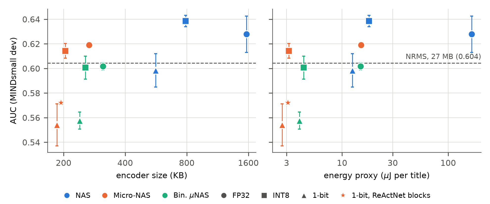

# MIND-Edge-Recommender

Code, board firmware and result files for the paper *A Byte-Level Multilingual News
Recommender for Microcontrollers* (in preparation; LaTeX source and PDF in `paper/`).

The recommender reads a news title as its UTF-8 bytes, so one 256-entry byte table serves
every language, where a word-based recommender keeps a word-embedding table of tens of
megabytes per language. A small char-CNN encodes the bytes. It is distilled from a frozen
multilingual sentence-transformer (`paraphrase-multilingual-MiniLM-L12-v2`), searched with
µNAS under the memory and operation budgets of two STM32 boards, and quantised to 8 bits and,
with ReActNet blocks, to one bit. Ranking quality is measured on MINDsmall and its 14 xMIND
translations; latency and energy on a NUCLEO-F401RE, an STM32H7B3I-DK and an Android phone.



## Layout

| Path | Content |
|---|---|
| `config.yaml` | settings of every run: data, teacher, student, search, quantisation, training |
| `src/` | data loading, teacher and student, recommender, NRMS baseline, search, quantisation, metrics, export |
| `scripts/` | experiments, exports, board and phone measurements, tables and figures |
| `unas/` | adapter for the µNAS searches under the board budgets (`unas/README.md`) |
| `firmware/` | board firmware for the 8-bit and one-bit encoders (`firmware/README.md`) |
| `models/` | the model files that ran on the boards and the phone, their byte tables and a SHA-256 manifest (`models/README.md`) |
| `notebooks/` | the pipeline from data to export in one notebook |
| `paper/` | LaTeX source, PDF, tables and figures |
| `paper/results/` | the result files behind the numbers of the paper |
| `docs/data_manifest.json` | SHA256 of the downloaded data files |

## Running

Install the packages of `requirements.txt` (`requirements-lock.txt` pins the versions we
used, with PyTorch for CUDA 13.0). On Windows, `scripts/setup_env.ps1` creates the virtual
environment, downloads the data and installs the packages.

```
python -m src.download             # MIND, xMIND and the NRMS utilities, with a SHA256 manifest
python -m scripts.run_matrix       # three search arms at three precisions, three seeds (Table 1)
python -m scripts.run_p1           # baselines and training variants (Table 2)
python -m scripts.run_binary       # one-bit encoder with ReActNet blocks
python -m scripts.run_unas_full    # encoders found by µNAS and the hand-designed comparators (Table 3)
python -m scripts.export_int8      # 8-bit files of those encoders and their accuracy
python -m scripts.replay_app       # replay of MIND through the ranking rule of the reader app
python -m scripts.make_figures     # figures from paper/results
python -m scripts.check_numbers    # compares every number in paper/paper.tex with paper/results
python -m scripts.export_release   # models/ from the run outputs (--checkpoints: archive of all checkpoints)
```

The paper builds in `paper/` with `pdflatex paper && bibtex paper && pdflatex paper && pdflatex paper`.
The µNAS searches are described in `unas/README.md`, the board measurements in
`firmware/README.md`. The reader app that runs the encoder on the phone is
[FeedWell-Edge](https://github.com/SepehrMohammady/FeedWell-Edge).

## Data and licences

| Dataset | Licence | Source |
|---|---|---|
| MIND | Microsoft Research License (non-commercial research) | Wu et al., ACL 2020; [Hugging Face mirror](https://huggingface.co/datasets/Recommenders/MIND) |
| xMIND | CC BY-NC-SA 4.0 | Iana et al., SIGIR 2024; [Hugging Face](https://huggingface.co/datasets/aiana94/xMINDsmall) |

Both datasets are for non-commercial research. Downloaded data (`data/`) and run outputs
(`artifacts/`) are not part of the repository.

## Licence

The code is under the MIT licence (`LICENSE`). Some files keep their own terms: the two HAL configuration
headers in `firmware/*/Core/Inc/` (STMicroelectronics, see their headers), `paper/llncs.cls` and
`paper/splncs04.bst` (Springer), and the model files in `models/`, which were trained on MIND and xMIND and
are for non-commercial research only.

## Reproducibility

- Every run script seeds Python, NumPy and PyTorch; the paper reports means and standard
  deviations over three seeds.
- `docs/data_manifest.json` pins the 31 downloaded files by SHA256.
- `scripts/check_numbers.py` fails when a number in the paper differs from the result files.
- The single runs of June 2026 (`paper/results/results_matrix.csv`, `results_summary.json`) are
  kept for comparison; the tables of the paper come from the seeded reruns.

## Citation

`CITATION.cff` describes this repository for GitHub's "Cite this repository" and for archiving. The
paper:

```bibtex
@misc{mind-edge-recommender2026,
  title = {A Byte-Level Multilingual News Recommender for Microcontrollers},
  note  = {In preparation},
  year  = {2026}
}
```
